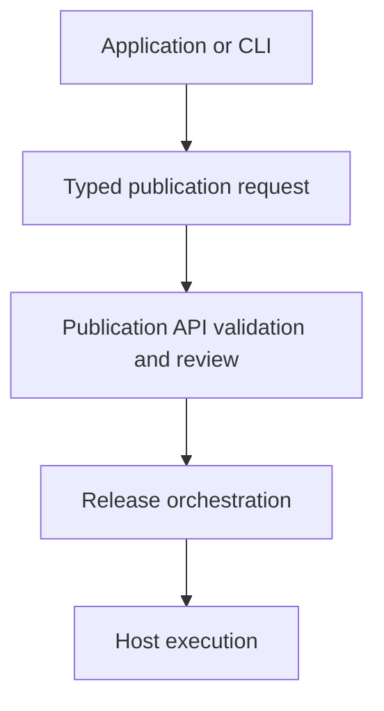
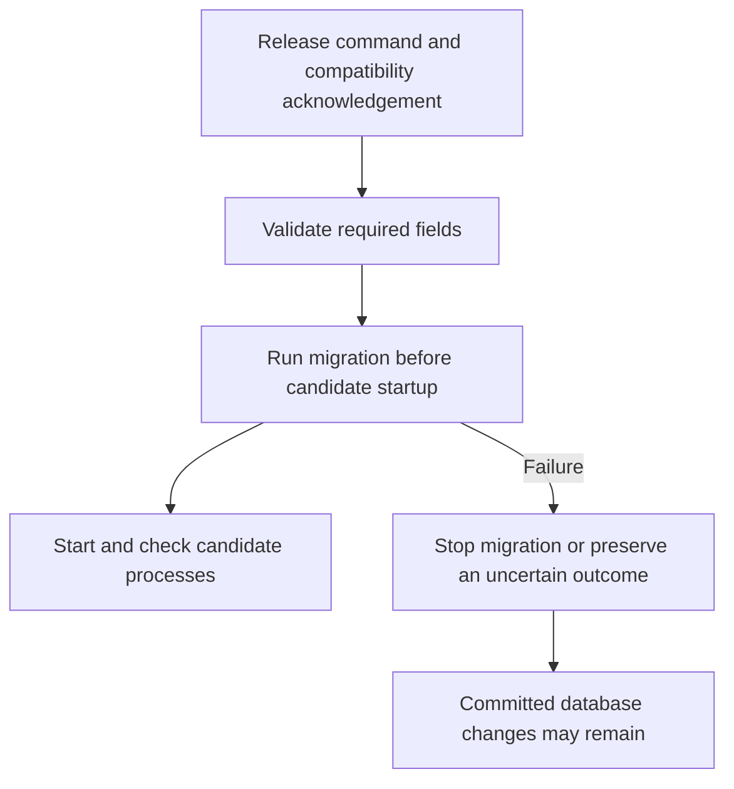

# SSH publication process contracts

An SSH app can use `PublicationSshRuntime` to describe separate web, worker and
scheduler roles. Each role supplies its command, instance count, CPU and memory
limits, and shutdown timeout. Existing single-command runtimes remain supported.

The SDK describes intent; the API validates it and the executor applies it.
The current SSH implementation supports exactly one web instance and up to 64
total process instances. `storagePath` selects the container mount location for
a managed persistent storage resource.

## Release migration acknowledgement

`release` describes a one-off command before candidate processes start. Its
`backwardCompatible: true` property is a required author acknowledgement that
the preceding release can continue using the database after that command runs.
The SDK type only accepts the literal `true`, and the API and executor reject a
release command without that acknowledgement.

This does not analyze SQL, inspect migration source, prove compatibility, or undo
committed database changes. A caller can incorrectly declare an unsafe migration
compatible. Review and test migrations against the preceding application release;
for example, introduce a nullable column while retaining the old column, then
remove the old column only after its rollback window closes.

Restoring a retained application release does not restore its database. Recovery
requires compatible application code and separate data backups when data itself
needs restoration.
